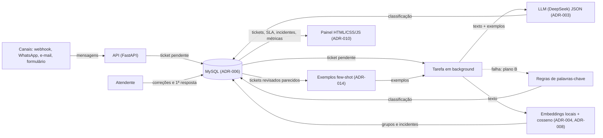

# Arquitetura

Visão geral da arquitetura: componentes, fluxo de dados e abstrações-chave.

## Componentes

| Componente | Tecnologia | Responsabilidade |
|------------|-----------|------------------|
| Webhook | FastAPI (ADR-001) | Recebe mensagens em um único endpoint, autenticado por chave, e responde `202` (ADR-009) |
| Canais | Webhook genérico, WhatsApp Cloud API, leitor IMAP e formulário público com limite de taxa (ADR-012, ADR-013) | Recebem mensagens reais; o simulador dispara as de demo |
| Exemplos (few-shot) | Busca por cosseno nos embeddings dos tickets já revisados (ADR-014) | Entrega ao classificador até 4 tickets parecidos com a classificação corrigida pelo atendente |
| Classificador | LLM (DeepSeek) com saída JSON (ADR-003), em background | Devolve assunto, urgência, sentimento, equipe e resposta sugerida; grava a versão do prompt e os exemplos usados; plano B por regras (ADR-009) |
| Agrupador | Embeddings locais em ONNX int8 (ADR-008, ADR-011) + cosseno com centroide (ADR-004) | Agrupa mensagens semelhantes e abre incidentes |
| Política de SLA | Tabela `sla_policy` (ADR-007) | Calcula prazo e estado (`no_prazo`, `em_risco`, `estourado`, `respondido`) |
| Banco | MySQL 8 via Docker (ADR-006) | Guarda tickets, embeddings, incidentes, correções, SLA e métricas |
| Painel | HTML, CSS e JavaScript puros, servidos pela API (ADR-010) | Exibe fila, alertas, prazos e métricas; o atendente corrige e responde |

## Fluxo de Dados

## Sequência principal

1. As mensagens chegam pelos canais (webhook com chave, WhatsApp com assinatura HMAC, leitor de e-mail ou formulário público com limite de taxa); na demo, o simulador usa o webhook.
2. O webhook valida, persiste o ticket como `pendente` e responde `202`.
3. A tarefa em background busca os tickets já revisados mais parecidos (few-shot) e chama o LLM com eles como exemplos (uma chamada por ticket); se falhar após uma nova tentativa, usa as regras de palavras-chave. A classificação é persistida com `origem`, `prompt_version` e os exemplos usados.
4. Em seguida, gera o embedding, compara com o centroide dos grupos abertos na janela de 30 min e abre incidente quando um grupo chega a 3 tickets.
5. O prazo do ticket é calculado a partir da urgência e da `sla_policy`.
6. O atendente confirma ou corrige a triagem e marca a primeira resposta; o ticket revisado passa a servir de exemplo para as próximas mensagens parecidas.
7. O painel calcula motivos de contato, incidentes, prazos em risco, SLI e precisão (por origem e por versão do prompt).
