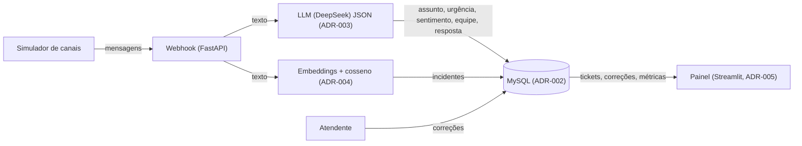

# Arquitetura

Visão geral da arquitetura: componentes, fluxo de dados e abstrações-chave.

## Componentes

| Componente | Tecnologia | Responsabilidade |
|------------|-----------|------------------|
| Webhook | FastAPI (ADR-001) | Recebe mensagens em um único endpoint |
| Simulador de canais | Script Python | Dispara mensagens de exemplo |
| Classificador | LLM (DeepSeek) com saída JSON (ADR-003) | Devolve assunto, urgência, sentimento, equipe e resposta sugerida |
| Agrupador | Embeddings + cosseno (ADR-004) | Agrupa mensagens semelhantes e abre incidentes |
| Banco | MySQL (ADR-002) | Guarda tickets, correções e métricas |
| Painel | Streamlit (ADR-005) | Exibe fila, alertas e métricas |

## Fluxo de Dados

## Sequência principal

1. O simulador dispara mensagens de exemplo para o webhook único.
2. O webhook chama o LLM (uma chamada por ticket) e persiste a classificação no MySQL.
3. Em paralelo, embeddings + similaridade de cosseno agrupam mensagens; 3+ acima de 0,80 em 30 min abrem incidente.
4. O atendente registra correções, persistidas no MySQL.
5. Métricas (motivos de contato, incidentes, prazos em risco, precisão) são calculadas e exibidas no Streamlit.
