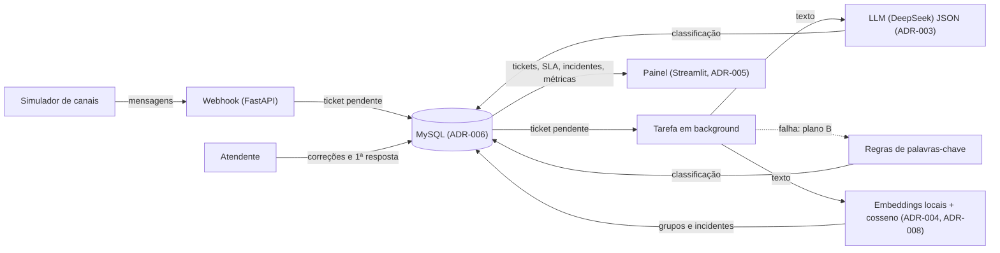

# Arquitetura

Visão geral da arquitetura: componentes, fluxo de dados e abstrações-chave.

## Componentes

| Componente | Tecnologia | Responsabilidade |
|------------|-----------|------------------|
| Webhook | FastAPI (ADR-001) | Recebe mensagens em um único endpoint, autenticado por chave, e responde `202` (ADR-009) |
| Simulador de canais | Script Python | Dispara mensagens de exemplo |
| Classificador | LLM (DeepSeek) com saída JSON (ADR-003), em background | Devolve assunto, urgência, sentimento, equipe e resposta sugerida; plano B por regras (ADR-009) |
| Agrupador | Embeddings locais (ADR-008) + cosseno com centroide (ADR-004) | Agrupa mensagens semelhantes e abre incidentes |
| Política de SLA | Tabela `sla_policy` (ADR-007) | Calcula prazo e estado (`no_prazo`, `em_risco`, `estourado`, `respondido`) |
| Banco | MySQL 8 via Docker (ADR-006) | Guarda tickets, embeddings, incidentes, correções, SLA e métricas |
| Painel | Streamlit (ADR-005) | Exibe fila, alertas, prazos e métricas |

## Fluxo de Dados

## Sequência principal

1. O simulador dispara mensagens de exemplo para o webhook único, com a chave de API no header.
2. O webhook valida, persiste o ticket como `pendente` e responde `202`.
3. A tarefa em background chama o LLM (uma chamada por ticket); se falhar após uma nova tentativa, usa as regras de palavras-chave. A classificação é persistida com `origem`.
4. Em seguida, gera o embedding, compara com o centroide dos grupos abertos na janela de 30 min e abre incidente quando um grupo chega a 3 tickets.
5. O prazo do ticket é calculado a partir da urgência e da `sla_policy`.
6. O atendente corrige a triagem e marca a primeira resposta; ambos são persistidos.
7. O painel calcula motivos de contato, incidentes, prazos em risco, SLI e precisão.
