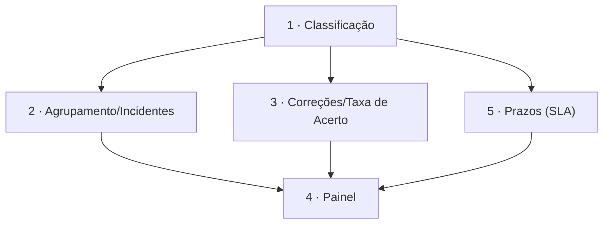

# Roadmap

Índice mestre de specs. Fonte única de verdade para o status de cada spec.

## Tabela de Specs

| # | Nome | Status | Referências |
|---|------|--------|-------------|
| 1 | Classificação de Solicitações (assunto, urgência, sentimento) | created | — |
| 2 | Agrupamento de Mensagens e Detecção de Incidentes | created | 1 |
| 3 | Registro de Correções e Taxa de Acerto | created | 1 |
| 4 | Painel de Monitoramento e Métricas | created | 1, 2, 3, 5 |
| 5 | Prazos de Resposta (SLA) e Primeira Resposta | created | 1 |

## Status

- `proposed` — ideia, sem spec escrita
- `planned` — entrada criada no roadmap
- `created` — documentos da spec criados
- `verified` — documentos verificados e corrigidos
- `in-progress` — código em desenvolvimento
- `implemented` — implementação concluída
- `audited` — auditado, feature live
- `discarded` — abandonado

## Grafo de Dependências

