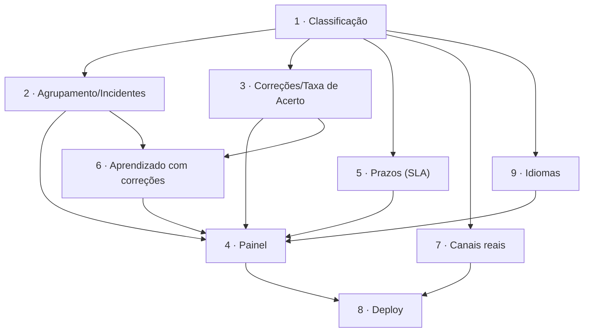

# Roadmap

Índice mestre de specs. Fonte única de verdade para o status de cada spec.

## Tabela de Specs

| # | Nome | Status | Referências |
|---|------|--------|-------------|
| 1 | Classificação de Solicitações (assunto, urgência, sentimento) | implemented | — |
| 2 | Agrupamento de Mensagens e Detecção de Incidentes | implemented (limiar calibrado em 0,60) | 1 |
| 3 | Registro de Correções e Taxa de Acerto | implemented | 1 |
| 4 | Painel de Monitoramento e Métricas | implemented | 1, 2, 3, 5 |
| 5 | Prazos de Resposta (SLA) e Primeira Resposta | implemented | 1 |
| 6 | Aprendizado com Correções (few-shot dinâmico, avaliação e versão do prompt) | implemented | 1, 2, 3 |
| 7 | Canais Reais e Entrada Pública (WhatsApp, e-mail, formulário com limite de taxa) | implemented | 1 |
| 8 | Deploy em Produção (Docker Compose, HTTPS, backup) | implemented (falta executar num servidor) | 4, 7 |
| 9 | Idioma do Cliente e Resposta no Mesmo Idioma | implemented | 1, 4 |

## Status

- `proposed` — ideia, sem spec escrita
- `planned` — entrada criada no roadmap
- `created` — documentos da spec criados
- `verified` — documentos verificados e corrigidos
- `in-progress` — código em desenvolvimento
- `implemented` — implementação concluída
- `audited` — auditado, feature live
- `discarded` — abandonado

## Grafo de Dependências

